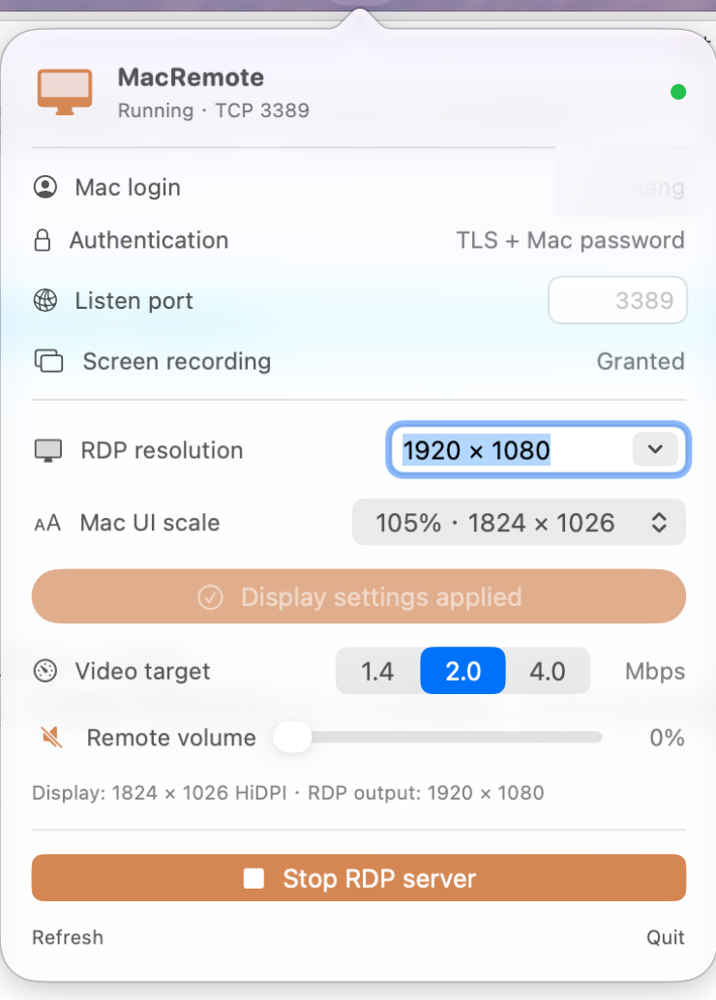
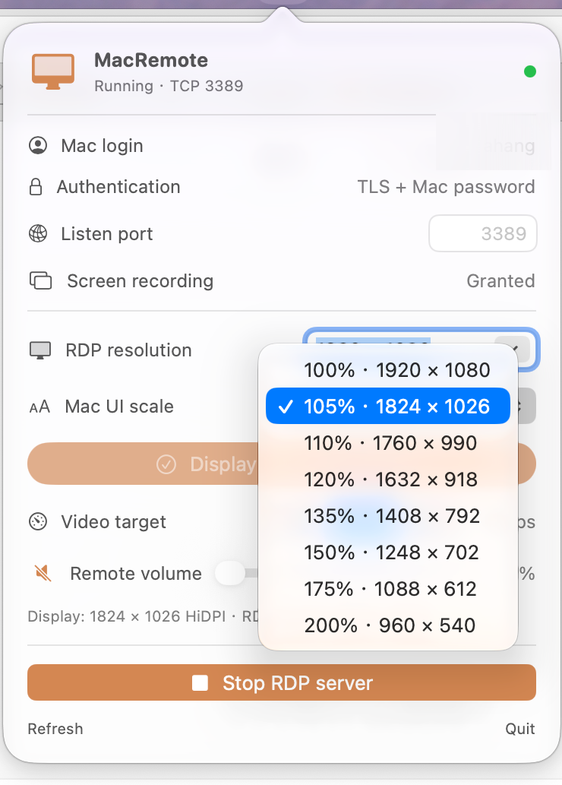

<p align="center">
  
</p>

<h1 align="center">MacRemote</h1>
<p align="center"><strong>Windows Remote Desktop. Now for your Mac.</strong></p>
<p align="center">
  Open `mstsc` on Windows and connect to the Mac you already use.<br>
  No extra Windows app. No cloud account. No relay server.
</p>

<p align="center">
  <a href="https://github.com/ahang39/MacRemote/releases/tag/v0.3.1-preview.1"></a>
  
  
  <a href="https://github.com/ahang39/MacRemote/actions/workflows/source-checks.yml"></a>
</p>
<p align="center">
  <a href="https://github.com/ahang39/MacRemote/releases/tag/v0.3.1-preview.1"><strong>Download for macOS</strong></a>
  &nbsp;·&nbsp; <a href="#get-started">Get started</a>
  &nbsp;·&nbsp; <a href="#features">Features</a>
  &nbsp;·&nbsp; <a href="README.zh-CN.md">简体中文</a>
</p>

<p align="center">
  <a href="docs/assets/macremote-settings.png"></a>
</p>
<p align="center"><sub>Real macOS menu bar interface · Live LAN session · Personal account details blurred</sub></p>

## Why MacRemote?

Windows already has an excellent RDP client. MacRemote gives your **existing, logged-in Mac desktop** a standard RDP endpoint—without another viewer, another identity system, or a subscription.

- **Use Windows' built-in client.** Open `mstsc`, connect over your LAN or VPN, and sign in with your Mac account.
- **Keep your Mac workflow.** Native keyboard and mouse input, bidirectional text/image clipboard, and built-in compatibility for supported Karabiner-Elements basic rules.
- **Make Retina readable.** Choose the RDP output resolution separately from the macOS HiDPI desktop. Adjust UI scale without forcing the remote video to use that same resolution.
- **Two clear bandwidth modes, live per device.** **High (LAN)** targets up to 60 fps / 100 Mbps VideoToolbox H.264 (no peak limiter) with 128 kbps stereo Opus; **Low (≤200 KB/s)** targets 200 KB/s total via 15 fps gating, VideoToolbox rate limits, a server token-bucket pacer, and 48 kbps stereo Opus; live switching and strict wire-rate enforcement await Windows validation.
- **Less work while disconnected.** Screen and system-audio capture start when a client connects and stop after the last disconnects.
- **A real Mac app.** Compact SwiftUI menu bar controls; self-contained binaries with pinned runtime dependencies—no Homebrew required to run the downloaded app.

## Get started

**Latest preview: [v0.3.1-preview.1](https://github.com/ahang39/MacRemote/releases/tag/v0.3.1-preview.1)** · macOS 14 or newer.

| Your Mac | Download |
| --- | --- |
| Apple Silicon (M1, M2, M3, M4 and newer) | **[MacRemote for Apple Silicon (.dmg)](https://github.com/ahang39/MacRemote/releases/download/v0.3.1-preview.1/MacRemote-v0.3.1-macos-arm64.dmg)** |
| Intel (x86_64) | **[MacRemote for Intel (.dmg)](https://github.com/ahang39/MacRemote/releases/download/v0.3.1-preview.1/MacRemote-v0.3.1-macos-x86_64.dmg)** |

1. Open the DMG and drag **MacRemote.app** into **Applications**. Grant **Screen & System Audio Recording** when prompted.
2. Start the RDP server from the menu bar (default **TCP 3389**).
3. On Windows, open the native credentials dialog with `mstsc /prompt /v:MAC_IP:3389`. Verify the server certificate and enter your Mac account credentials. If Windows offers to remember them, later connect with `mstsc /v:MAC_IP:3389` or your saved RDP profile.

For diagnostics when mstsc does not prompt, use python3 tools/make-mstsc-profile.py --host MAC_IP --output MacRemote.rdp. This is not a guaranteed fix: cached credentials and policy can bypass prompting, and unsigned RDP files show an extra Windows security warning since April 2026. A zero-setup server-side solution is being evaluated (docs/qa/2026-11-19-mstsc-credential-prompt.md).

These preview packages use a **fixed self-signed release certificate (`Ahang Open Source Release Signing`)** and are **not notarized**. If macOS blocks the first launch, use **System Settings → Privacy & Security → Open Anyway**. When upgrading from earlier `v0.2.x` ad-hoc builds, macOS may ask you to remove and re-grant **Screen & System Audio Recording** (and **Accessibility**) once because the signing identity changed; future updates signed with the same release certificate will keep a consistent identity. Connect over a trusted private network or VPN; don't expose TCP 3389 directly to the Internet.

> [!NOTE]
> The [v0.3.1-preview.1 release](https://github.com/ahang39/MacRemote/releases/tag/v0.3.1-preview.1) and its source archives are published from the same source revision as the attached DMGs. The older v0.2.0 release tag remains unchanged.

## Features

| | What you get |
| --- | --- |
| **Standard RDP** | Native Windows `mstsc` support, FreeRDP 3.33.1 Shadow, TLS + macOS PAM login |
| **HiDPI display** | Separate RDP output and Mac UI scaling; 8 scale levels from 100% to 200%; reuse compatible existing HiDPI modes |
| **Per-device settings** | Remember a client's output resolution, nominal scale, selected HiDPI mode, bandwidth mode (`High`/`Low`) and audio preferences |
| **Low-latency H.264** | VideoToolbox AVC420 with rewritten zero-reorder SPS VUI, 1 s rate limits, server byte pacer in Low mode and live telemetry (KB/s, FPS, ACK RTT) |
| **Remote sound** | 48 kHz stereo Opus over `rdpsnd` (128 kbps High / 48 kbps Low), silence suppression, remote gain and strict mute |
| **On-demand capture** | Suspend ScreenCaptureKit video/audio capture after the last client disconnects; restart for a new client |
| **Keyboard & mouse** | Native Quartz input and an in-process Karabiner basic-rule compatibility layer |
| **Clipboard** | Two-way Unicode text and image transfer with PNG/DIB handling and line-ending normalization |
| **Native management** | SwiftUI status menu, permissions, configurable port, start/stop and recovery controls |

### Retina, without a one-size-fits-all desktop

MacRemote separates **transport pixels** from **macOS logical desktop pixels**. Pick an RDP output such as 1920 × 1080, then choose **100%, 105%, 110%, 120%, 135%, 150%, 175% or 200%** Mac UI scaling. It reuses matching existing HiDPI modes; a missing mode can be created on demand and loaded after a macOS restart.

<p align="center">
  <a href="docs/assets/macremote-hidpi-scales.png"></a>
</p>
<p align="center"><sub>Eight non-linear scaling levels, showing the actual resolved HiDPI sizes</sub></p>

### High (LAN) & Low (≤200 KB/s WAN) bandwidth modes

MacRemote uses a single hardware-accelerated **VideoToolbox H.264/AVC420** pipeline with low-latency SPS VUI signaling (`max_num_reorder_frames=0`, `max_dec_frame_buffering=1`) and two live per-device bandwidth modes—switchable mid-session without disconnecting:

| Mode | Video | Audio (stereo Opus) | Flow control |
| --- | --- | --- | --- |
| **High · LAN** *(default)* | Up to **60 fps** · **100 Mbps** ceiling (no `DataRateLimits`) | **128 kbps** (16 KB/s) | 8 frames in flight, uncapped pacer |
| **Low · ≤200 KB/s** | Up to **15 fps** · **1.05 Mbps** avg (`DataRateLimits` 1.2×/1 s) | **48 kbps** (6 KB/s) | **155 KB/s** token-bucket video pacer, 3 frames in flight |

Clients negotiating `<32-bit` color automatically fall back to legacy RDP `BitmapUpdate`. The menu bar displays real 1 Hz server telemetry (outbound KB/s, sent FPS, and RDPGFX frame-ACK RTT). See [ADR-0012](docs/adr/0012-bandwidth-profiles-and-low-latency-h264.md) and the [local hardware VideoToolbox benchmark](docs/qa/2026-11-21-bandwidth-profiles-refactor.md).

In an earlier controlled Windows `mstsc` test at **2 Mbps downlink + 80 ms added RTT**, lowering the AVC420 target from **4.0 to 1.4 Mbps** reduced median scrolling downlink volume by **44%** and first visible scrolling feedback from **3.30 s to 0.99 s** ([test setup and results](docs/qa/2026-11-17-mstsc-wan.md)).

## Under the hood

`Windows mstsc → RDP over TLS → FreeRDP Shadow → ScreenCaptureKit / VideoToolbox → your logged-in Mac desktop`

MacRemote combines C/Objective-C server components with an AppKit/SwiftUI menu bar app. It uses existing macOS capture and input APIs, bundles its dependencies, and doesn't require a proprietary protocol or a cloud service.

**Current scope:** the already logged-in macOS desktop, verified with macOS TLS + PAM. Standard 32-bit clients stream hardware VideoToolbox H.264/AVC420 while `<32-bit` clients automatically use legacy `BitmapUpdate`. Windows `mstsc` WAN acceptance under 200 KB/s shaping, audio negotiation, and reconnect edge cases continue to be tested.

Read the [architecture](docs/ARCHITECTURE.md), [technical decisions](docs/adr/), [test matrix](docs/TESTING.md), and [release checklist](docs/RELEASE_CHECKLIST.md).

## Native Windows sign-in and remembered credentials

Start MacRemote from the menu bar and sign in with the current Mac user's credentials. If you previously used the experimental Windows sign-in setup, use the Mac account password at the next native prompt. A distinct RDP password from the experiment will fail PAM authentication. MacRemote leaves existing enrollment files and Windows credentials in place. If Windows tries the old password, use the native prompt to update the credential for this MacRemote target.

Windows and its policies control whether saved credentials are offered and reused. A client configured to require NLA cannot connect with this build. Saved-credential reuse after restarting `mstsc` and the server still requires validation on the affected managed client. See the [Windows acceptance checks](docs/TESTING.md#saved-credentials-on-windows).

## Headless desktop (development build)

The menu-bar app uses an automatic virtual-screen fallback **only when macOS has no online display**. Existing physical monitors and BetterDisplay-created virtual monitors are reused and never recreated or disconnected. For command-line use, add --headless to macremote serve; the default fallback size is 1920x1080, or your saved RDP output size. Requires an already logged-in macOS GUI session and Screen Recording permission. The new virtual-display backend is compiled and has passed no-op/runtime-selector tests; **real zero-monitor Windows mstsc capture is not yet validated**.

## Build from source

**v0.3.1 updates:** Consolidated into two live per-device bandwidth modes (**High · LAN** and **Low · ≤200 KB/s**), rewritten low-latency H.264 SPS VUI (`max_num_reorder_frames=0`, `max_dec_frame_buffering=1`), server-side 1 Hz throughput/FPS/ACK-RTT telemetry, and a redesigned grouped menu bar popover (see [ADR-0012](docs/adr/0012-bandwidth-profiles-and-low-latency-h264.md)). Real Windows `mstsc` end-to-end validation is pending.

On macOS 14+ with Xcode Command Line Tools, CMake, Ninja, pkg-config, Perl and Python 3:

```bash
git clone https://github.com/ahang39/MacRemote.git
cd MacRemote
./tools/build-dev-app.sh
```

The standalone app is generated under `.build/output/`. The build pins FreeRDP and builds private dependencies. See the [build guide](docs/m2/README.md). Build from `main` for the latest preview source.

## Project

This is an **alpha preview**, developed with real Windows RDP compatibility and reproducible testing as priorities. Contributions and clear bug reports are welcome: [Contributing](CONTRIBUTING.md) · [Security](SECURITY.md) · [Issues](https://github.com/ahang39/MacRemote/issues).

**License:** [PolyForm Noncommercial 1.0.0](LICENSE) for MacRemote; bundled dependencies retain their [respective licenses](THIRD_PARTY_NOTICES.md).

## Friends

[LINUX DO — 新的理想型社区](https://linux.do/)
