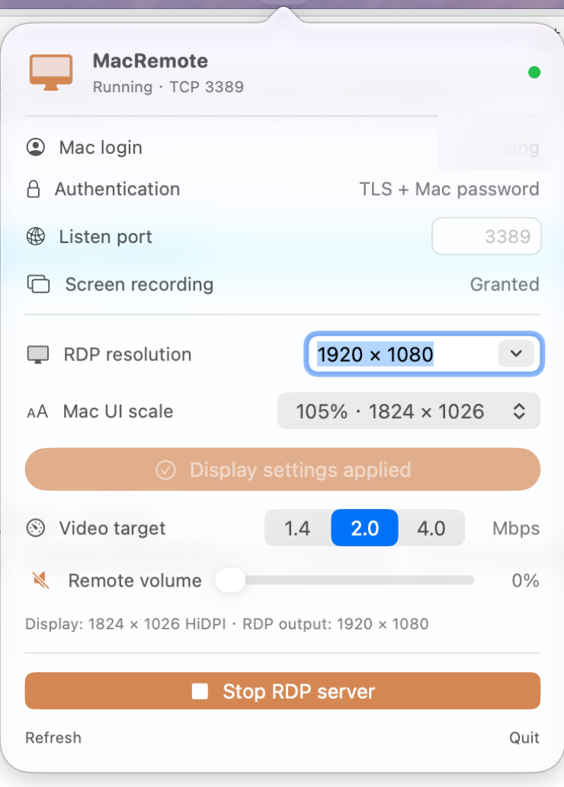

<p align="center">
  
</p>

<h1 align="center">MacRemote</h1>
<p align="center"><strong>Windows 自带远程桌面，直接连接你的 Mac。</strong></p>
<p align="center">
  打开 `mstsc`，就能操作 Mac 当前的桌面。<br>
  不用安装专门的 Windows 客户端，不用注册新账号，也不需要云端中转。
</p>

<p align="center">
  <a href="https://github.com/ahang39/MacRemote/releases/tag/v0.2.1-adhoc.1"></a>
  
  
  <a href="https://github.com/ahang39/MacRemote/actions/workflows/source-checks.yml"></a>
</p>
<p align="center">
  <a href="https://github.com/ahang39/MacRemote/releases/tag/v0.2.1-adhoc.1"><strong>下载 MacRemote</strong></a>
  &nbsp;·&nbsp; <a href="#下载安装">下载安装</a>
  &nbsp;·&nbsp; <a href="#主要功能">主要功能</a>
  &nbsp;·&nbsp; <a href="README.md">English</a>
</p>

<p align="center">
  <a href="docs/assets/macremote-settings.png"></a>
</p>
<p align="center"><sub>真实 macOS 菜单栏界面 · 本机账户信息已模糊处理</sub></p>

## 为什么选择 MacRemote？

Windows 本来就自带好用的远程桌面。MacRemote 做的事情很直接：**让 Mac 当前已登录的桌面支持标准 RDP 连接**，保留你的键盘习惯、剪贴板以及显示设置。

- **Windows 零额外客户端。** 打开 `mstsc`，输入 Mac 地址，使用已有 Mac 账户密码登录。
- **保留日常操作习惯。** 原生键鼠、双向文本与图片剪贴板，以及内置 Karabiner-Elements 基础映射规则兼容。
- **让 Retina 显示更舒服。** RDP 传输分辨率和 Mac 桌面 HiDPI 缩放分开设置，不必为了放大界面同步提高传输像素数。
- **不同设备有自己的设置。** 记住每个客户端的显示偏好、视频目标码率和远程音量；H.264/AVC420 可动态选择 1.4 / 2.0 / 4.0 Mbps，音频使用立体声 Opus。
- **断开后停止采集。** 首个 RDP 客户端连接后才启动屏幕和系统音频采集，最后一个客户端断开便停止，减少空闲资源占用。
- **原生 Mac 体验。** 小巧的 SwiftUI 菜单栏界面，安装包自带运行依赖，目标机器不需要安装 Homebrew。

## 下载安装

**最新预览版：[v0.2.1-adhoc.1](https://github.com/ahang39/MacRemote/releases/tag/v0.2.1-adhoc.1)** · 要求 macOS 14 或更新版本。

| Mac 机型 | 下载 |
| --- | --- |
| Apple Silicon（M1/M2/M3/M4 等） | **[Apple Silicon 版 DMG](https://github.com/ahang39/MacRemote/releases/download/v0.2.1-adhoc.1/MacRemote-v0.2.1-macos-arm64.dmg)** |
| Intel（x86_64） | **[Intel 版 DMG](https://github.com/ahang39/MacRemote/releases/download/v0.2.1-adhoc.1/MacRemote-v0.2.1-macos-x86_64.dmg)** |

1. 打开 DMG，将 **MacRemote.app** 拖进「应用程序」，按提示授予「屏幕与系统音频录制」权限。
2. 从菜单栏启动 RDP 服务，默认监听 **TCP 3389**。
3. 在 Windows 打开 `mstsc`，连接 `Mac的IP:3389`，用已有 Mac 用户名和密码登录。

当前 DMG 使用 **Ad-hoc 签名，尚未经过 Apple 公证**。首次启动被阻止时，在「系统设置 → 隐私与安全性 → 仍要打开」中允许。建议通过可信局域网或 VPN 使用，不要把 RDP 端口直接暴露到公网。

> [!NOTE]
> [v0.2.1-adhoc.1 Release](https://github.com/ahang39/MacRemote/releases/tag/v0.2.1-adhoc.1) 的源码压缩包与安装包对应同一源码版本。旧 v0.2.0 标签保留历史状态，不再修改。

## 主要功能

| 能力 | 实现 |
| --- | --- |
| **标准 RDP** | Windows `mstsc`、FreeRDP 3.33.1 Shadow、TLS + macOS PAM 账号登录 |
| **Retina / HiDPI** | RDP 输出与 Mac UI 缩放独立；100%～200% 共 8 档；优先复用已有 HiDPI 分辨率 |
| **客户端独立偏好** | 记住输出分辨率、标称缩放、实际 HiDPI 模式、视频目标码率及音频设置 |
| **H.264 视频** | VideoToolbox 加速 AVC420，可实时调整目标码率，处理显示比例及鼠标坐标映射 |
| **远程音频** | 客户端支持时通过 `rdpsnd` 传输 48 kHz 立体声 Opus，独立音量与严格静音 |
| **按需屏幕采集** | 最后一个客户端断开后停止 ScreenCaptureKit 视频与系统音频采集，重连时恢复 |
| **键鼠控制** | 原生 Quartz 输入，内置 Karabiner basic manipulator 兼容层 |
| **双向剪贴板** | Unicode 文本、PNG/DIB 图片与 Windows 换行符处理 |
| **原生管理** | SwiftUI 菜单栏、权限检查、端口配置、服务启停及故障恢复 |

### Retina 缩放，不再被传输分辨率绑住

比如 RDP 输出选择 **1920 × 1080**，Mac 界面可以单独选择 **100%、105%、110%、120%、135%、150%、175%、200%**。能复用现有 HiDPI 模式就直接复用；缺少的分辨率按需创建，重启 macOS 加载后再应用。

<p align="center">
  <a href="docs/assets/macremote-hidpi-scales.png"></a>
</p>
<p align="center"><sub>八档非线性缩放，菜单中直接显示实际对应的 HiDPI 分辨率</sub></p>

### 弱网优化有实测数据

一次真实 Windows `mstsc` 对照实验，在**下行 2 Mbps、额外 80 ms RTT** 的条件下，将 AVC420 编码目标由 **4.0 降至 1.4 Mbps**，五秒合成滚动场景的下行流量中位数**减少 44%**，第一次滚动画面反馈从 **3.30 秒降至 0.99 秒**。数据来自受控测试场景，环境和逐轮数据见[完整测试记录](docs/qa/2026-11-17-mstsc-wan.md)。

## 技术架构

`Windows mstsc → TLS/RDP → FreeRDP Shadow → ScreenCaptureKit / VideoToolbox → 当前登录的 macOS 桌面`

服务端使用 C/Objective-C，界面使用 AppKit/SwiftUI；没有自定义远控协议，不需要云账号或额外常驻中转服务。第三方依赖固定版本并打包进 App。

**当前范围：**连接 Mac 已登录的桌面，不包括开机前的 FileVault 解锁界面和 macOS 登录界面。认证使用 TLS + PAM，暂不支持 NLA；AVC444 仍属实验性模式。不同客户端的音频协商、输入法和重连边界持续实测优化。

更多细节：[技术架构](docs/ARCHITECTURE.md) · [设计决策](docs/adr/) · [测试矩阵](docs/TESTING.md) · [发布清单](docs/RELEASE_CHECKLIST.md)。

## 从源码构建

需要 macOS 14+、Xcode Command Line Tools、CMake、Ninja、pkg-config、Perl 和 Python 3：

```bash
git clone https://github.com/ahang39/MacRemote.git
cd MacRemote
./tools/build-dev-app.sh
```

构建完成后在 `.build/output/` 得到包含私有运行时依赖的 App。详见[构建指南](docs/m2/README.md)。从 `main` 分支可以获得完整 v0.2.1 预览版源码。

## 项目与贡献

MacRemote 仍处于 **Alpha 预览阶段**，以真实 Windows `mstsc` 兼容性和可复现实测为开发依据。欢迎提交问题及改进：[参与贡献](CONTRIBUTING.md) · [安全政策](SECURITY.md) · [Issues](https://github.com/ahang39/MacRemote/issues)。

**许可证：**MacRemote 使用 [PolyForm Noncommercial 1.0.0](LICENSE)，第三方组件保留各自[许可证与声明](THIRD_PARTY_NOTICES.md)。

## 友情链接

[LINUX DO — 新的理想型社区](https://linux.do/)
