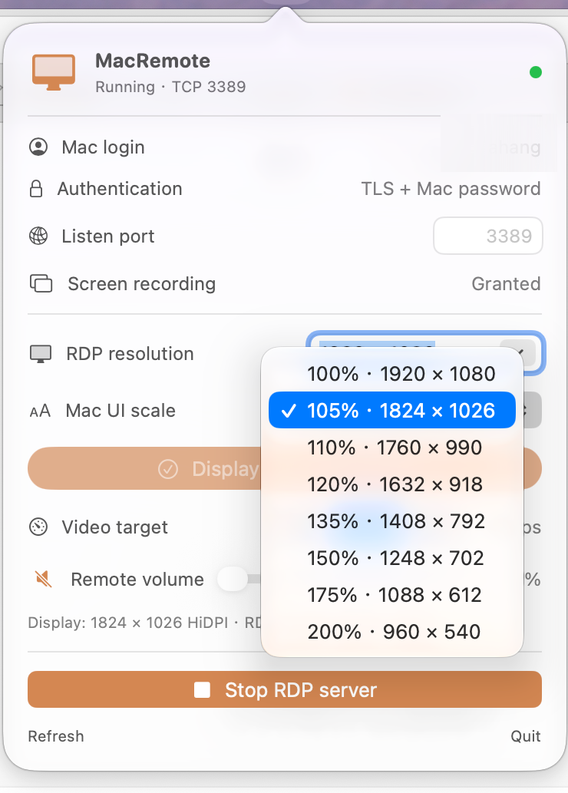

<p align="center">
  
</p>

<h1 align="center">MacRemote</h1>
<p align="center"><strong>Windows 自带远程桌面，直接连接你的 Mac。</strong></p>
<p align="center">
  打开 `mstsc`，就能操作 Mac 当前的桌面。<br>
  不用安装专门的 Windows 客户端，不用注册新账号，也不需要云端中转。
</p>

<p align="center">
  <a href="https://github.com/ahang39/MacRemote/releases/tag/v0.3.1-preview.1"></a>
  
  
  <a href="https://github.com/ahang39/MacRemote/actions/workflows/source-checks.yml"></a>
</p>
<p align="center">
  <a href="https://github.com/ahang39/MacRemote/releases/tag/v0.3.1-preview.1"><strong>下载 MacRemote</strong></a>
  &nbsp;·&nbsp; <a href="#下载安装">下载安装</a>
  &nbsp;·&nbsp; <a href="#主要功能">主要功能</a>
  &nbsp;·&nbsp; <a href="README.md">English</a>
</p>

<p align="center">
  <a href="docs/assets/macremote-settings.png"></a>
</p>
<p align="center"><sub>真实 macOS 菜单栏界面 · 内网实时连接状态 · 本机账户信息已模糊处理</sub></p>

## 为什么选择 MacRemote？

Windows 本来就自带好用的远程桌面。MacRemote 做的事情很直接：**让 Mac 当前已登录的桌面支持标准 RDP 连接**，保留你的键盘习惯、剪贴板以及显示设置。

- **Windows 零额外客户端。** 打开 `mstsc`，输入 Mac 地址，使用已有 Mac 账户密码登录。
- **保留日常操作习惯。** 原生键鼠、双向文本与图片剪贴板，以及内置 Karabiner-Elements 基础映射规则兼容。
- **让 Retina 显示更舒服。** RDP 传输分辨率和 Mac 桌面 HiDPI 缩放分开设置，不必为了放大界面同步提高传输像素数。
- **高/低两档带宽，按设备实时切换。** **高带宽（内网）** 支持最高 60 fps / 100 Mbps VideoToolbox H.264（不设峰值限流）与 128 kbps 立体声 Opus；**低带宽（≤200 KB/s 外网）** 通过 15 fps 限帧、VideoToolbox 峰值限速、服务端令牌桶限流与 48 kbps 立体声 Opus，以总流量 200 KB/s 为目标，支持在线切换（严格限流与真实 Windows 客户端仍待验证）。
- **断开后停止采集。** 首个 RDP 客户端连接后才启动屏幕和系统音频采集，最后一个客户端断开便停止，减少空闲资源占用。
- **原生 Mac 体验。** 小巧的 SwiftUI 菜单栏界面，安装包自带运行依赖，目标机器不需要安装 Homebrew。

## 下载安装

**最新预览版：[v0.3.1-preview.1](https://github.com/ahang39/MacRemote/releases/tag/v0.3.1-preview.1)** · 要求 macOS 14 或更新版本。

| Mac 机型 | 下载 |
| --- | --- |
| Apple Silicon（M1/M2/M3/M4 等） | **[Apple Silicon 版 DMG](https://github.com/ahang39/MacRemote/releases/download/v0.3.1-preview.1/MacRemote-v0.3.1-macos-arm64.dmg)** |
| Intel（x86_64） | **[Intel 版 DMG](https://github.com/ahang39/MacRemote/releases/download/v0.3.1-preview.1/MacRemote-v0.3.1-macos-x86_64.dmg)** |

1. 打开 DMG，将 **MacRemote.app** 拖进「应用程序」，按提示授予「屏幕与系统音频录制」权限。
2. 从菜单栏启动 RDP 服务，默认监听 **TCP 3389**。
3. Windows 首次使用 `mstsc /prompt /v:Mac的IP:3389` 打开原生凭据窗口。验证服务端证书后，输入 Mac 用户名和密码。如果 Windows 提供保存选项，之后可用 `mstsc /v:Mac的IP:3389` 或已保存的 RDP 文件连接。

如果 mstsc 不弹密码框，可用 python3 tools/make-mstsc-profile.py --host Mac的IP --output MacRemote.rdp 做诊断，但客户端缓存和策略可能阻止弹框；2026 年 4 月后未签名 .rdp 文件还会增加发布者警告。零配置方案仍在验证，见 docs/qa/2026-11-19-mstsc-credential-prompt.md。

当前 DMG 使用**固定自签名发布证书（`Ahang Open Source Release Signing`），尚未经过 Apple 公证**。首次启动被阻止时，在「系统设置 → 隐私与安全性 → 仍要打开」中允许。从旧版 `v0.2.x`（Ad-hoc 签名）升级时，由于代码签名身份变化，macOS 可能需要你在隐私设置中先移除再重新勾选一次「屏幕与系统音频录制」（以及「辅助功能」）；后续同证书更新可保持身份稳定，通常不再需要重复授权。建议通过可信局域网或 VPN 使用，不要把 RDP 端口直接暴露到公网。

> [!NOTE]
> [v0.3.1-preview.1 Release](https://github.com/ahang39/MacRemote/releases/tag/v0.3.1-preview.1) 的源码压缩包与安装包对应同一源码版本。旧 v0.2.0 标签保留历史状态，不再修改。

## 主要功能

| 能力 | 实现 |
| --- | --- |
| **标准 RDP** | Windows `mstsc`、FreeRDP 3.33.1 Shadow、TLS + macOS PAM 账号登录 |
| **Retina / HiDPI** | RDP 输出与 Mac UI 缩放独立；100%～200% 共 8 档；优先复用已有 HiDPI 分辨率 |
| **客户端独立偏好** | 记住输出分辨率、标称缩放、实际 HiDPI 模式、带宽模式（高/低）及音频设置 |
| **低延迟 H.264** | VideoToolbox AVC420 + SPS VUI 零重排改写、1 秒峰值限速、低带宽令牌桶控流及实时速率/帧率/ACK 延迟显示 |
| **远程音频** | 客户端支持时通过 `rdpsnd` 传输 48 kHz 立体声 Opus（高带宽 128 kbps / 低带宽 48 kbps），静音抑制与严格静音 |
| **按需屏幕采集** | 最后一个客户端断开后停止 ScreenCaptureKit 视频与系统音频采集，重连时恢复 |
| **键鼠控制** | 原生 Quartz 输入，内置 Karabiner basic manipulator 兼容层 |
| **双向剪贴板** | Unicode 文本、PNG/DIB 图片与 Windows 换行符处理 |
| **原生管理** | SwiftUI 菜单栏、权限检查、端口配置、服务启停及故障恢复 |

### Retina 缩放，不再被传输分辨率绑住

比如 RDP 输出选择 **1920 × 1080**，Mac 界面可以单独选择 **100%、105%、110%、120%、135%、150%、175%、200%**。能复用现有 HiDPI 模式就直接复用；缺少的分辨率按需创建，重启 macOS 加载后再应用。

<p align="center">
  <a href="docs/assets/macremote-hidpi-scales.png"></a>
</p>
<p align="center"><sub>八档非线性缩放，菜单中直接显示实际对应的 HiDPI 分辨率</sub></p>

### 高带宽（内网）与低带宽（≤200 KB/s 外网）双档

MacRemote 统一使用硬件加速的 **VideoToolbox H.264/AVC420** 管线，通过改写 SPS VUI（`max_num_reorder_frames=0`、`max_dec_frame_buffering=1`）消除解码端多帧缓存，并提供两档按设备记忆、在线实时切换的带宽模式（切换不断连）：

| 模式 | 视频流 | 远程音频（立体声 Opus） | 流量控制 |
| --- | --- | --- | --- |
| **High · LAN**（新设备默认） | 最高 **60 fps** · **100 Mbps** 上限（不设 `DataRateLimits`） | **128 kbps**（16 KB/s） | 最多 8 帧在途，不限速 |
| **Low · ≤200 KB/s** | 最高 **15 fps** · **1.05 Mbps** 平均码率（1 秒峰值限速 1.2×） | **48 kbps**（6 KB/s） | **155 KB/s** 服务端令牌桶限流，最多 3 帧在途 |

协商 `<32` 位色的客户端会自动退回经典 `BitmapUpdate` 兼容路径。菜单栏每秒刷新真实服务端发送速率（KB/s）、发送 FPS 与 RDPGFX 帧确认 RTT。详见 [ADR-0012](docs/adr/0012-bandwidth-profiles-and-low-latency-h264.md) 与 [本机硬件 VideoToolbox 基准实测](docs/qa/2026-11-21-bandwidth-profiles-refactor.md)。

早期真实 Windows `mstsc` 对照实验（**下行 2 Mbps、额外 80 ms RTT**）显示，降低 AVC420 编码目标（4.0 → 1.4 Mbps）可使五秒滚动下行流量中位数**减少 44%**、首次滚动反馈从 **3.30 秒降至 0.99 秒**（[完整测试记录](docs/qa/2026-11-17-mstsc-wan.md)）。

## 技术架构

`Windows mstsc → TLS/RDP → FreeRDP Shadow → ScreenCaptureKit / VideoToolbox → 当前登录的 macOS 桌面`

服务端使用 C/Objective-C，界面使用 AppKit/SwiftUI；没有自定义远控协议，不需要云账号或额外常驻中转服务。第三方依赖固定版本并打包进 App。

**当前范围：**连接 Mac 已登录的桌面，使用 TLS + PAM 验证 Mac 账号。32 位色客户端统一走硬件 VideoToolbox H.264/AVC420，`<32` 位色客户端自动降级为 `BitmapUpdate`。200 KB/s 限速下的真实外网 `mstsc` 验收、音频协商和重连边界持续实测优化。

更多细节：[技术架构](docs/ARCHITECTURE.md) · [设计决策](docs/adr/) · [测试矩阵](docs/TESTING.md) · [发布清单](docs/RELEASE_CHECKLIST.md)。

## Windows 原生登录与记住密码

从菜单栏启动 MacRemote，用当前 Mac 账号登录。如果用过实验版的 Windows 登录设置，下次在原生凭据窗口中使用 Mac 账号密码。实验版单独设置的 RDP 密码无法通过 PAM。MacRemote 会保留原有登记文件和 Windows 凭据。如果 Windows 尝试使用旧密码，请在原生窗口更新此 MacRemote 目标对应的凭据。

保存和复用凭据取决于 Windows 及其策略。要求 NLA 的客户端无法连接此版本。在受影响的受管客户端上，退出 `mstsc` 或重启服务后能否复用凭据，仍需实测。[Windows 验收步骤](docs/TESTING.md#saved-credentials-on-windows)

## 无屏幕远程（开发版）

菜单栏启动 RDP 时，如果 macOS **完全没有在线显示器**，MacRemote 自动创建自有虚拟屏；已有实体屏或 BetterDisplay 虚拟屏时不创建、不释放第三方显示器。命令行需在 macremote serve 后明确加 --headless。默认 1920×1080，也可读取原有 RDP 输出分辨率。需已登录 macOS 桌面并授予屏幕录制权限。虚拟显示器实现、运行时 API 检查及有屏无副作用测试已通过；**真实完全无屏的 Windows mstsc 画面尚未验收**。

## 从源码构建

**v0.3.1 更新：** 收敛为「高带宽（内网）/ 低带宽（≤200 KB/s 外网）」两档按设备实时切换模式，内置 H.264 SPS VUI 零缓冲改写、服务端 1 Hz 实时流量/帧率/ACK 延迟统计与重构后的分组卡片菜单栏界面（详见 [ADR-0012](docs/adr/0012-bandwidth-profiles-and-low-latency-h264.md)）。真实 Windows `mstsc` 端到端验收待进行。

需要 macOS 14+、Xcode Command Line Tools、CMake、Ninja、pkg-config、Perl 和 Python 3：

```bash
git clone https://github.com/ahang39/MacRemote.git
cd MacRemote
./tools/build-dev-app.sh
```

构建完成后在 `.build/output/` 得到包含私有运行时依赖的 App。详见[构建指南](docs/m2/README.md)。从 `main` 分支可以获得完整 v0.3.1 预览版源码。

## 项目与贡献

MacRemote 仍处于 **Alpha 预览阶段**，以真实 Windows `mstsc` 兼容性和可复现实测为开发依据。欢迎提交问题及改进：[参与贡献](CONTRIBUTING.md) · [安全政策](SECURITY.md) · [Issues](https://github.com/ahang39/MacRemote/issues)。

**许可证：**MacRemote 使用 [PolyForm Noncommercial 1.0.0](LICENSE)，第三方组件保留各自[许可证与声明](THIRD_PARTY_NOTICES.md)。

## 友情链接

[LINUX DO — 新的理想型社区](https://linux.do/)
